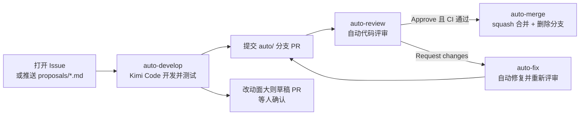

# IPQC

IPQC 已迁移到 `GD-SaiKen` 组织，并使用组织级中心仓库 [GD-SaiKen/auto-dev](https://github.com/GD-SaiKen/auto-dev) 提供的 AI 自动开发流水线。

本仓库只保留 5 个薄 Workflow，负责接收事件、传递参数和授权；方案、开发、评审、修复、合并的完整实现由中心仓库统一维护。

## 前端应用（IPQC 智能质量工作台）

```bash
pnpm install
pnpm extract-seed   # 从 docs/原型 HTML 抽取 real/fqc 等种子 JSON
pnpm dev            # http://localhost:5173
pnpm lint           # vue-tsc 类型检查
pnpm test
pnpm build
```

工程路径：`apps/web`（Vue 3 + Element Plus + Pinia，数据存 localStorage）。

功能模块：总看板（KPI 对比 / 热力矩阵 / 走势）、车间总览、首件巡检（标准索引 + NG 5 步闭环）、终检 FQC、零件投诉闭环、关键点检、培训与技能矩阵、工作绩效、数据与口径设置。页面支持内联编辑、搜索分页、CSV / JSON 导出、单表撤销与打印版式；口径与验收见产品 SDD。

## 流程



## 在 IPQC 中使用

1. 在仓库 **Settings → Secrets and variables → Actions** 配置 Secret `LLM_API_KEY`；
2. 直接新建 Issue，或推送 `proposals/*.md`。小白向全流程见中心仓库 [流水线全流程](https://github.com/GD-SaiKen/auto-dev/blob/main/docs/流水线全流程.md)；提 Issue 写法见 [怎么提 Issue](https://github.com/GD-SaiKen/auto-dev/blob/main/docs/怎么提Issue.md)。本仓模板在 `.github/ISSUE_TEMPLATE/`。写不全也会开始处理；
3. 开发、PR、评审、修复和合并接着自动执行。改动跨多个功能，或动到对外接口、权限、数据结构时，PR 保持草稿。评审打回或 `ci` 失败都会自动修复，合计最多 3 轮 `auto: fix` 提交。PR 上的 `ci` 跑 lint、test、build，没通过不会自动合并（可人工合并）。

可选 Variables：`LLM_MODEL`（默认 `kimi-for-coding`）、`LLM_BASE_URL`、`KIMI_CLI_VERSION`（默认 `latest`）。

## 在其他组织仓库中复用

复制中心仓库的 `examples/consumer/.github/workflows/` 下 5 个文件到目标仓库相同位置，保持文件名不变，然后：

1. 配置目标仓库的 `LLM_API_KEY`；
2. 直接新建 Issue，或把方案放进 `proposals/`。可选模板在中心仓库 `examples/consumer/.github/ISSUE_TEMPLATE/`。

详细接入说明见[中心仓库 README](https://github.com/GD-SaiKen/auto-dev#readme)。业务仓库不需要复制 Prompt 或安装 Action。

## 安全控制

- 业务仓库显式传递自己的模型 Secret，中心仓库不保存该 Key；
- 禁止 Agent 提交对 `.github/` 的修改；
- fork PR 不运行带模型凭据的评审；
- 只有 `auto/` 分支和机器人对当前 head SHA 的 Approved 评审可以进入自动合并；
- 合并 API 原子校验 head SHA，避免旧评审合入新提交。

## 版本引用

当前 5 个调用 Workflow 引用中心仓库 `@main`，会随中心更新。需要不可变版本时，可改成中心仓库的 release tag 或 commit SHA。

## 设计文档（SDD）

增量规格与实施计划统一维护在 **`docs/SDD/`**（格式见 dev-standards · sdd）：

| 主题 | 规格 | 实施计划 |
| --- | --- | --- |
| IPQC 智能质量工作台 | [26-11-09 IPQC智能质量工作台](docs/SDD/规格文档/26-11-09%20IPQC智能质量工作台.md) | [实现计划](docs/SDD/实施计划/26-11-05%20IPQC智能工作台%20实现计划.md) |
| 组织级自动开发流水线 | [26-11-06 组织级自动开发流水线](docs/SDD/规格文档/26-11-06%20组织级自动开发流水线.md) | [实现计划](docs/SDD/实施计划/26-11-06%20组织级自动开发流水线%20实现计划.md) |

- 原型基线：[docs/原型/IPQC智能工作台1-2026-11-5.html](docs/原型/IPQC智能工作台1-2026-11-5.html)
- 业务约定：[docs/项目-业务约定.md](docs/项目-业务约定.md)
- 历史（superpowers，只读）：[docs/superpowers/](docs/superpowers/)
